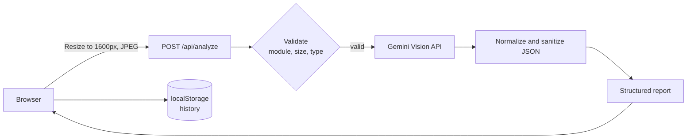

<div align="center">

# 🩺 MedScan AI

**A privacy-conscious, educational medical image review tool powered by multimodal AI**

[](https://react.dev/)
[](https://www.typescriptlang.org/)
[](https://vitejs.dev/)
[](https://ai.google.dev/)
[](https://vercel.com/)
[](https://opensource.org/licenses/MIT)

[**Live Demo**](https://med-scan-ai-chi.vercel.app) · [**Report a Bug**](https://github.com/Valentina14142000/MedScan-AI/issues) · [**Request a Feature**](https://github.com/Valentina14142000/MedScan-AI/issues)

<br />


</div>

---

> [!WARNING]
> **MedScan AI is NOT a medical device.** It does not diagnose, treat, prevent or cure any condition and must never be used to guide clinical decisions or emergency care. Results can be wrong. Upload only public or fully de-identified educational images. For health concerns, see a qualified clinician; in an emergency, contact your local emergency services immediately.

## Table of Contents

- [🩺 MedScan AI](#-medscan-ai)
  - [Table of Contents](#table-of-contents)
  - [Overview](#overview)
  - [Features](#features)
  - [How It Works](#how-it-works)
  - [Tech Stack](#tech-stack)
  - [Getting Started](#getting-started)
    - [Prerequisites](#prerequisites)
    - [Installation](#installation)
    - [Run locally](#run-locally)
    - [Scripts](#scripts)
  - [Deployment](#deployment)
  - [API Reference](#api-reference)
    - [`POST /api/analyze`](#post-apianalyze)
  - [Project Structure](#project-structure)
  - [Safety and Privacy Design](#safety-and-privacy-design)
  - [Known Limitations](#known-limitations)
  - [License](#license)

## Overview

MedScan AI is an open-source educational project that demonstrates how multimodal large language models can support medical image review workflows. Upload a **chest X-ray**, **brain MRI slice** or **skin photograph** and receive a structured report with:

- visible observations,
- an image-quality assessment,
- general points a clinician may want to consider,
- a routine / soon / urgent follow-up indicator.

It is designed for learning and research, with safety guardrails built into both the prompt and the server-side validation.

## Features

| | Feature | Details |
|---|---|---|
| 🧠 | **Three review modules** | Chest X-ray, Brain MRI and Dermatology workspaces |
| 🔍 | **Modality check** | Images that do not match the selected module are rejected rather than analyzed |
| 📋 | **Structured reports** | Observations, considerations, follow-up flag, limitations |
| 🚫 | **No diagnoses or scores** | The model is instructed never to diagnose or give probabilities; output is validated server-side |
| 🔒 | **No image storage** | Images are processed in memory and never saved by the app |
| 📊 | **Local analytics** | Case history and charts kept only in your browser (`localStorage`) |
| 📥 | **Exports** | Download a text report or a CSV of your history |
| ✨ | **Polished UI** | Dark clinical interface with a live scan animation, responsive down to mobile |

## How It Works



1. The browser resizes the image to at most 1600 px and re-encodes it as JPEG.
2. The serverless function validates the module, MIME type and size, applies a rate limit, then calls Gemini with the API key kept server-side.
3. Transient errors (429/5xx) are retried with backoff and fall back to an alternate model.
4. The response is parsed and normalized: unknown fields are dropped, enums are clamped, and list lengths are capped.
5. The report is shown in the UI, and only a small summary is saved to browser storage.

## Tech Stack

| Layer | Technology |
|---|---|
| Frontend | React 18, TypeScript (strict), Vite 5, Tailwind CSS, Lucide icons |
| Backend | Vercel Serverless Function (`/api/analyze`), shared core reused by the Vite dev server |
| AI | Google Gemini Vision (default `gemini-3.8-flash`, fallback `gemini-flash-latest`, override with `GEMINI_MODEL`) |
| Storage | Browser `localStorage` only; no database |
| Hosting | Vercel |

## Getting Started

### Prerequisites

- Node.js 20 or newer
- A free Gemini API key from [Google AI Studio](https://aistudio.google.com/apikey)

### Installation

```bash
git clone https://github.com/Valentina14142000/MedScan-AI.git
cd MedScan-AI
npm install
cp .env.example .env
```

Open `.env` and set your key:

```
GEMINI_API_KEY=your_key_here
```

### Run locally

```bash
npm run dev
```

Open <http://localhost:5173>. The same analysis code that runs in production is served at `/api/analyze` through a Vite middleware.

### Scripts

| Command | Purpose |
|---|---|
| `npm run dev` | Start the dev server with the API middleware |
| `npm run typecheck` | Strict TypeScript checks for app and server code |
| `npm run build` | Production build |
| `npm run lint` | ESLint |

## Deployment

Deploy for free on [Vercel](https://vercel.com):

1. Push this repository to GitHub.
2. In Vercel choose **Add New → Project** and import the repo (Vite is detected automatically).
3. Add the environment variable `GEMINI_API_KEY` and mark it **Sensitive**.
4. Click **Deploy**.
5. If visitors are asked to sign in, disable **Settings → Deployment Protection → Vercel Authentication**.

| Variable | Required | Description |
|---|---|---|
| `GEMINI_API_KEY` | Yes | Google AI Studio API key (server-side only) |
| `GEMINI_MODEL` | No | Override the default model name |

## API Reference

### `POST /api/analyze`

Request body:

```json
{
  "module": "xray",
  "image": "<base64 JPEG, no data: prefix>",
  "mime": "image/jpeg",
  "note": "Optional context, up to 400 characters"
}
```

`module` is one of `xray`, `mri` or `skin`.

Successful response (`200`):

```json
{
  "ok": true,
  "model": "gemini-3.8-flash",
  "result": {
    "image_type_match": true,
    "quality": "good",
    "quality_note": "...",
    "observations": ["..."],
    "considerations": ["A clinician may want to evaluate ..."],
    "follow_up": "routine",
    "follow_up_note": "...",
    "limitations": "..."
  }
}
```

Errors return `{ "ok": false, "error": "..." }` with status `400` (bad input), `413` (image too large), `429` (rate limited), `500` (missing key) or `502` (AI provider unavailable).

## Project Structure

```
MedScan-AI/
├── api/
│   ├── analyze.ts          # Vercel function: POST /api/analyze
│   └── _lib/analyze.ts     # Validation, prompt, Gemini call, retry, output normalization
├── src/
│   ├── components/         # Workspace, ResultView, History
│   ├── data/modules.ts     # Module definitions
│   ├── lib/                # Image prep, API client, history/export helpers
│   ├── App.tsx
│   └── index.css
├── docs/screenshot.png
├── vite.config.ts          # Dev middleware that serves /api/analyze
└── vercel.json
```

## Safety and Privacy Design

- **Educational framing everywhere:** persistent disclaimer, consent checkbox before every analysis, and "not a diagnosis" on every report.
- **No diagnoses or confidence scores:** enforced in the prompt and by output normalization.
- **Conservative triage:** when unsure, the model is told to choose "soon" over "routine".
- **No server-side storage:** the app has no database and does not save images.
- **Secrets stay on the server:** the API key is never sent to the browser or committed (`.env` is git-ignored).

## Known Limitations

- Output comes from a general-purpose AI model, **not** a validated clinical system, and may be inaccurate or incomplete.
- Free Gemini keys have rate limits, and on the free tier Google may use submitted content to improve its products. Use only public or de-identified images.
- The built-in rate limiter is in-memory and resets on cold starts; it is a courtesy guard, not a security control.
- Browser history is per device and is lost if site data is cleared.

## License

Distributed under the [MIT License](https://opensource.org/licenses/MIT).

<div align="center">

Built for learning. **Not for clinical use.**

</div>
