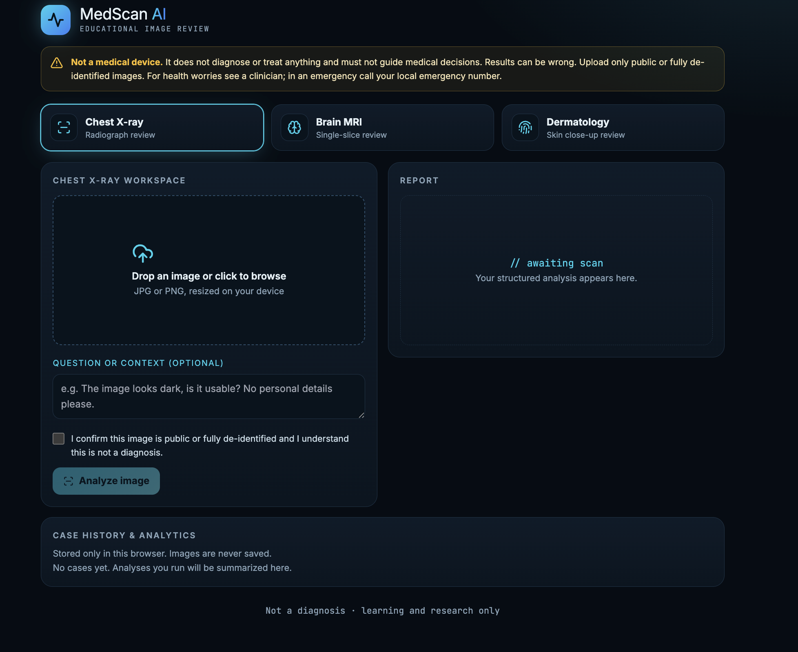

# 🩺 MedScan AI

**An Intelligent, Privacy-First Educational Medical Image Review Tool**

---

> ⚠️ **Important Disclaimer**
> **MedScan AI is NOT a medical device.** It does not diagnose, treat, prevent, or cure any condition, and must **never** be used to guide clinical decisions or emergency medical care. Results can be wrong. Upload only public or fully de-identified educational images. In case of a health worry, see a clinician; in an emergency, contact your local emergency services immediately.

---

## 📸 Overview

**MedScan AI** is an open-source educational platform designed to demonstrate the application of multimodal Large Language Models (LLMs) to medical imaging review. Users can upload a **Chest X-Ray**, **Brain MRI slice**, or **Dermatology photo** to receive structured visual observations, image quality evaluations, clinical consideration points, and routine follow-up triage indicators.

## What it really does

- Sends the image to a Google Gemini vision model through a small serverless function (`api/analyze.ts`). The API key stays on the server.
- Checks that the image matches the selected modality; mismatches are rejected instead of "analyzed".
- Never outputs a diagnosis, probabilities or confidence scores. Responses are validated and normalized server-side.
- Keeps case history and analytics **only in your browser** (`localStorage`). Images are never stored.
- Exports a text report and a CSV of your history.

  ---

## 🏗️ Architecture & Tech Stack

* **Frontend**: React 18, TypeScript, Tailwind CSS, Lucide Icons
* **Build System**: Vite with built-in development API middleware
* **AI Engine**: Google Gemini Vision Model (`gemini-1.5-flash` or custom override)
* **Backend Functions**: Vercel Serverless Functions (`/api/analyze`)

---

